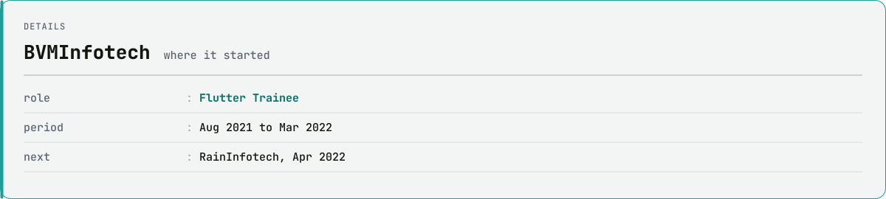
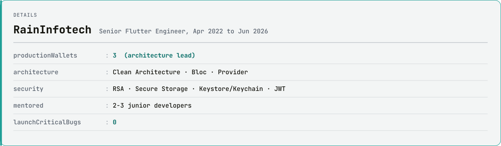
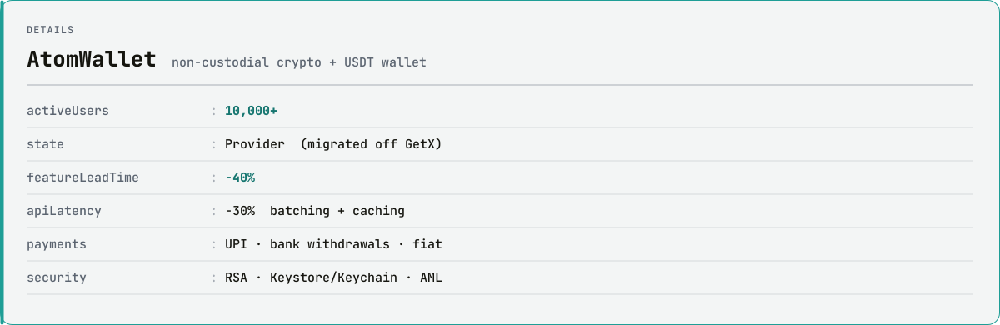
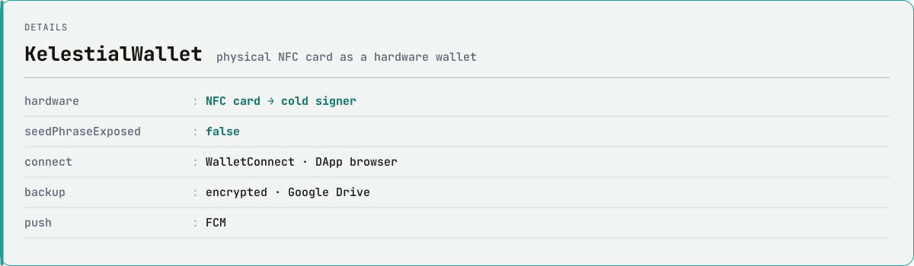
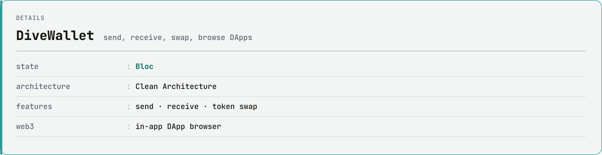
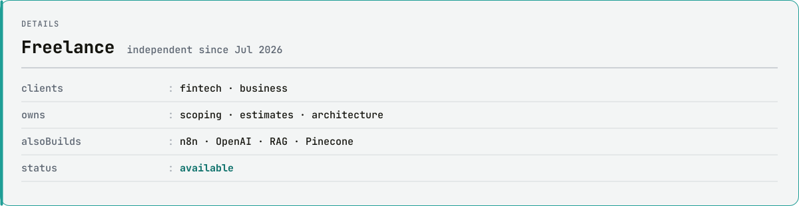
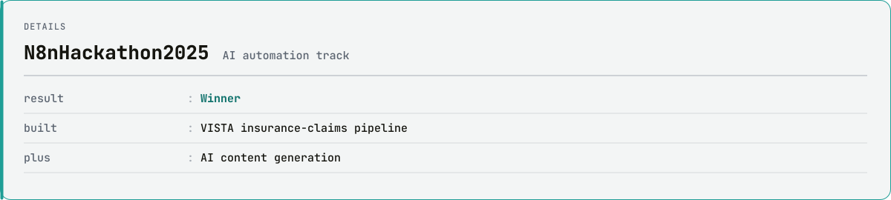
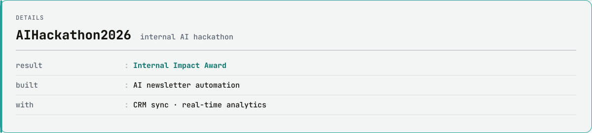

<picture>
  <source media="(prefers-color-scheme: dark)" srcset="assets/hero-dark.svg">
  
</picture>

<br>

I build Flutter apps where a wrong tap costs someone real money: crypto wallets, UPI payouts, NFC cards that sign transactions without ever exposing a seed phrase. Four years, 30+ apps, and the biggest one runs for 10,000+ people.

<br>

<picture>
  <source media="(prefers-color-scheme: dark)" srcset="assets/inspector-dark.svg">
  
</picture>

<sub>&nbsp;Tap a node to inspect it</sub>

<details><summary><code>BVMInfotech</code> <sub>trainee · 2021</sub></summary>
<picture><source media="(prefers-color-scheme: dark)" srcset="assets/nodes/bvm-card-dark.svg"></picture>
</details>
<details><summary><code>RainInfotech</code> <sub>senior · 2022-26</sub></summary>
<picture><source media="(prefers-color-scheme: dark)" srcset="assets/nodes/rain-card-dark.svg"></picture>
</details>
<details><summary>&nbsp;&nbsp;&nbsp;&nbsp;├─ <code>AtomWallet</code> <sub>10K+ users</sub></summary>
<picture><source media="(prefers-color-scheme: dark)" srcset="assets/nodes/atomwallet-card-dark.svg"></picture>
</details>
<details><summary>&nbsp;&nbsp;&nbsp;&nbsp;├─ <code>KelestialWallet</code> <sub>NFC cold wallet</sub></summary>
<picture><source media="(prefers-color-scheme: dark)" srcset="assets/nodes/kelestialwallet-card-dark.svg"></picture>
</details>
<details><summary>&nbsp;&nbsp;&nbsp;&nbsp;└─ <code>DiveWallet</code> <sub>Bloc</sub></summary>
<picture><source media="(prefers-color-scheme: dark)" srcset="assets/nodes/divewallet-card-dark.svg"></picture>
</details>
<details><summary><code>Freelance</code> <sub>2026 →</sub></summary>
<picture><source media="(prefers-color-scheme: dark)" srcset="assets/nodes/freelance-card-dark.svg"></picture>
</details>
<details><summary><code>N8nHackathon2025</code> <sub>winner</sub></summary>
<picture><source media="(prefers-color-scheme: dark)" srcset="assets/nodes/n8nhackathon2025-card-dark.svg"></picture>
</details>
<details><summary><code>AIHackathon2026</code> <sub>impact award</sub></summary>
<picture><source media="(prefers-color-scheme: dark)" srcset="assets/nodes/aihackathon2026-card-dark.svg"></picture>
</details>


```console
$ flutter doctor --prapti
Doctor summary (to see all details, hire me):
[✓] Flutter         4+ yrs, stable channel, 30+ apps shipped
[✓] Architecture    Clean Architecture · Bloc · Provider (and the GetX migration scars)
[✓] Security        RSA key storage · Keystore / Keychain · Secure Storage · JWT
[✓] Web3            WalletConnect · DApp browser · NFC hardware signing
[✓] Firebase        Auth · Firestore · FCM · Crashlytics
[✓] AI automation   n8n · OpenAI · RAG · Pinecone   (n8n Hackathon 2025 winner)
[✓] Shipping        Play Store + App Store, zero critical bugs at launch
[!] Availability
    ✗ Not on a full-time contract right now. Freelance and full-time both welcome.

• 1 issue found. Fastest fix: an email.
```

<picture>
  <source media="(prefers-color-scheme: dark)" srcset="assets/frames-dark.svg">
  
</picture>

<p align="center">
  <a href="mailto:prapti.chauhan@outlook.com"><b>prapti.chauhan@outlook.com</b></a>
  &nbsp;·&nbsp;
  <a href="https://www.linkedin.com/in/prapti-chauhan">LinkedIn</a>
  &nbsp;·&nbsp;
  Surat, IN (UTC+5:30)
</p>

<p align="center"><sub>
No stat cards, no badge walls, no third-party widgets. Every graphic here is plain SVG generated by a small Python script:
glyphs shaped with HarfBuzz and baked into paths, so the typography survives GitHub's image proxy, and the chart rebuilds itself daily.
Source in <a href="scripts">/scripts</a>.
</sub></p>
