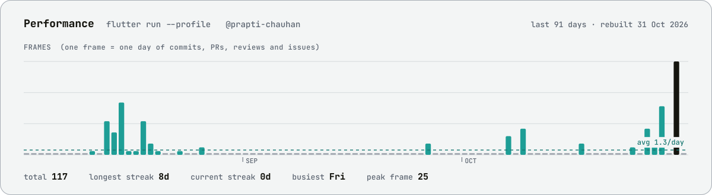

<picture>
  <source media="(prefers-color-scheme: dark)" srcset="assets/hero-dark.svg">
  
</picture>

<br>

I build Flutter apps where a wrong tap costs someone real money: crypto wallets, UPI payouts, NFC cards that sign transactions without ever exposing a seed phrase. Four years, 30+ apps, and the biggest one runs for 10,000+ people.

<br>

<picture>
  <source media="(prefers-color-scheme: dark)" srcset="assets/inspector-dark.svg">
  
</picture>

```console
$ flutter doctor --prapti
Doctor summary (to see all details, hire me):
[✓] Flutter         4+ yrs, stable channel, 30+ apps shipped
[✓] Architecture    Clean Architecture · Bloc · Provider (and the GetX migration scars)
[✓] Security        RSA key storage · Keystore / Keychain · Secure Storage · JWT
[✓] Web3            WalletConnect · DApp browser · NFC hardware signing
[✓] Firebase        Auth · Firestore · FCM · Crashlytics
[✓] AI automation   n8n · OpenAI · RAG · Pinecone   (n8n Hackathon 2025 winner)
[✓] Shipping        Play Store + App Store, zero critical bugs at launch
[!] Availability
    ✗ Not on a full-time contract right now. Freelance and full-time both welcome.

• 1 issue found. Fastest fix: an email.
```

<picture>
  <source media="(prefers-color-scheme: dark)" srcset="assets/frames-dark.svg">
  
</picture>

<p align="center">
  <a href="mailto:prapti.chauhan@outlook.com"><b>prapti.chauhan@outlook.com</b></a>
  &nbsp;·&nbsp;
  <a href="https://www.linkedin.com/in/prapti-chauhan">LinkedIn</a>
  &nbsp;·&nbsp;
  Surat, IN (UTC+5:30)
</p>

<p align="center"><sub>
No stat cards, no badge walls, no third-party widgets. Every graphic here is plain SVG generated by a small Python script:
glyphs shaped with HarfBuzz and baked into paths, so the typography survives GitHub's image proxy, and the chart rebuilds itself daily.
Source in <a href="scripts">/scripts</a>.
</sub></p>
