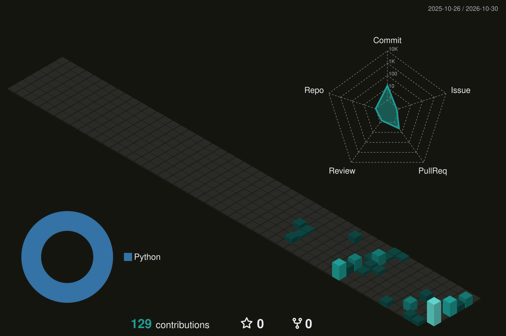

<!-- Animated wave header -->


<!-- Typing animation -->
<p align="center">
  <a href="https://git.io/typing-svg">
    
  </a>
</p>

<p align="center">
  <a href="https://linkedin.com/in/prapti-chauhan"></a>
  <a href="mailto:prapti.chauhan@outlook.com"></a>
  
</p>

---

## 🚀 About me

```dart
class Prapti extends Developer {
  final String role       = "Senior Flutter Developer";
  final String location   = "Surat, India 🇮🇳";
  final int    experience = 4; // years, and counting
  final List<String> focus = ["Fintech", "Crypto Wallets", "App Security"];
  final List<String> extras = ["AI Automation", "n8n", "RAG"];

  @override
  String get currently => "Freelancing: idea → shipped app 🚢";

  @override
  bool get openToWork => true;
}
```

---

## 🛠️ Tech stack

<p align="center">
  
</p>
<p align="center">
  
  
  
  
  
  
  
</p>

---

## 📱 Featured apps

<table>
  <tr>
    <td width="50%" valign="top">
      <h3>🔐 Atom Wallet</h3>
      <p>Non-custodial crypto & USDT wallet with UPI payments, bank withdrawals and fiat conversion.</p>
      <p><b>10K+ users</b> · RSA key encryption · AML checks</p>
    </td>
    <td width="50%" valign="top">
      <h3>💳 Kelestial Wallet</h3>
      <p>Turns a physical NFC card into a hardware wallet. Your seed phrase is never exposed.</p>
      <p>WalletConnect · DApp browser · Encrypted backup</p>
    </td>
  </tr>
  <tr>
    <td width="50%" valign="top">
      <h3>🌊 DiveWallet</h3>
      <p>Crypto wallet with send, receive, token swaps and DApp browsing.</p>
      <p>Bloc · Clean Architecture</p>
    </td>
    <td width="50%" valign="top">
      <h3>✉️ AI Email Writing</h3>
      <p>Writes and suggests emails with AI, monetized with AdMob.</p>
      <p>OpenAI · Google AdMob</p>
    </td>
  </tr>
</table>

> 🔒 Most of my client work lives in private repos. Happy to walk through the architecture on a call.

---

## 🏆 Wins & impact

| | |
|---|---|
| ⚡ **~40% faster** feature delivery | Rebuilt a wallet's state layer from GetX to modular Provider |
| 📉 **30% lower** API latency | Request batching, caching and smarter state handling |
| 🧱 **3 production wallets** | Led architecture, shipped with zero critical bugs at launch |
| 🥇 **Winner, n8n Hackathon 2025** | AI insurance claims pipeline |
| 🏅 **Impact Award, AI Hackathon 2026** | AI newsletter automation with CRM integration |

---

<!-- HIDDEN until public activity grows. Remove these comment markers to bring it back.
## 📊 GitHub stats

<p align="center">
  
</p>

<p align="center">
  
</p>
-->

---

<p align="center">
  <b>💼 Open to freelance Flutter projects & senior roles</b><br/>
  Let's build something secure and beautiful together. <a href="mailto:prapti.chauhan@outlook.com">Say hi 👋</a>
</p>


