  &nbsp;

<b>A few highlights from 30+ apps</b> · most client work lives in private repos, happy to walk through the architecture on a call

  &nbsp;

  &nbsp;

<!-- HIDDEN until public activity grows. Remove these comment markers to bring it back.
## 📊 GitHub stats

  

  

-->
